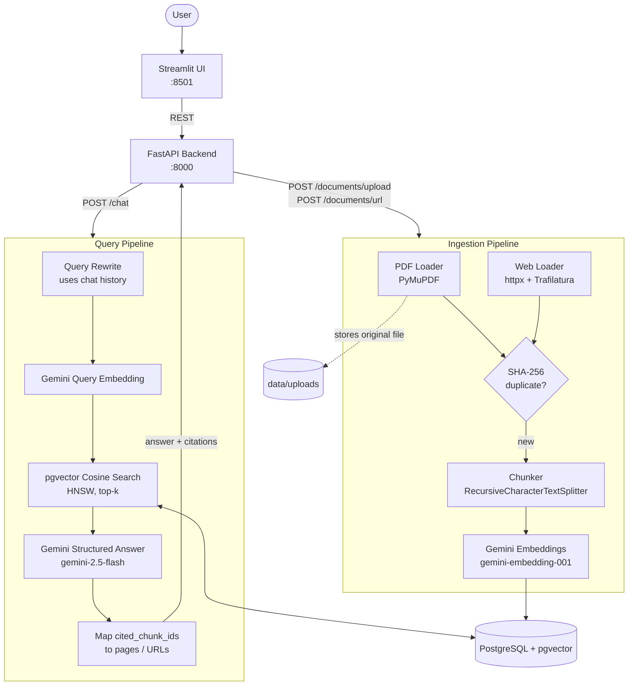

# Document Intelligence RAG (Retrieval-Augmented Generation)

A production-minded Retrieval-Augmented Generation (RAG) application built with **FastAPI**, **PostgreSQL (`pgvector`)**, **Google Gemini**, and **Streamlit**.

Upload PDF documents or submit website URLs, index their contents into vector embeddings, and ask conversational natural-language questions grounded strictly in your sources with page-level and URL citations.

---

## Demo

<video src="docs/demo.mp4" controls muted width="100%"></video>

[▶ Watch the demo video](docs/demo.mp4): upload a PDF, index it, and ask grounded questions with page-level citations.

---

## Core Features

- **PDF Ingestion (`PyMuPDF`):** Page-by-page extraction preserving 1-indexed page numbers, with `%PDF-` header validation, file size limits, and path traversal protection.
- **Website Ingestion (`Trafilatura` + `httpx`):** Extracts clean article text, page titles, and canonical URLs while blocking private/loopback IP ranges to prevent SSRF.
- **SHA-256 Deduplication:** Prevents re-embedding identical PDFs or webpages.
- **Semantic Vector Search (`pgvector`):** Stores 768-dimensional Google Gemini embeddings (`models/gemini-embedding-001`) in PostgreSQL with HNSW cosine indexing and `ON DELETE CASCADE`.
- **Grounded Answers & Structured Citations (`gemini-2.5-flash`):** Uses Gemini Structured Outputs to map `cited_chunk_ids` deterministically back to exact PDF pages and URLs, plus conversational query rewriting for multi-turn follow-up questions.
- **Interactive Streamlit UI:** Manage indexed documents, filter chat scope to specific sources, and inspect expandable source snippets.

---

## Architecture



---

## Quickstart (Option A — Docker Compose)

1. **Configure `.env`:**
   ```bash
   cp .env.example .env
   # Add your GEMINI_API_KEY in .env
   ```

2. **Start all services (PostgreSQL + `pgvector`, FastAPI backend, Streamlit frontend):**
   ```bash
   docker compose up --build
   ```

3. **Open in your browser:**
   - **Streamlit Web UI:** [http://localhost:8501](http://localhost:8501)
   - **FastAPI Swagger Docs:** [http://localhost:8000/docs](http://localhost:8000/docs)
   - **Health Check:** [http://localhost:8000/health](http://localhost:8000/health)

---

## Quickstart (Option B — Local Development with `uv`)

1. **Install dependencies and configure `.env`:**
   ```bash
   uv sync
   cp .env.example .env
   # Add your GEMINI_API_KEY in .env
   ```

2. **Start PostgreSQL with `pgvector` and run migrations:**
   ```bash
   docker compose up -d postgres
   uv run alembic upgrade head
   ```

3. **Start the FastAPI backend:**
   ```bash
   uv run uvicorn app.main:app --reload --port 8000
   ```

4. **Start the Streamlit frontend (in a second terminal):**
   ```bash
   uv run streamlit run frontend/streamlit_app.py
   ```

---

## REST API Endpoints

| Method | Endpoint | Description |
|---|---|---|
| `GET` | `/health` | Health check and active Gemini model configuration |
| `POST` | `/documents/upload` | Upload and index a PDF file (`multipart/form-data`) |
| `POST` | `/documents/url` | Fetch and index a public webpage (`{"url": "https://..."}`) |
| `GET` | `/documents` | List all indexed documents with status and chunk counts |
| `GET` | `/documents/{id}` | Inspect a single document's metadata and status |
| `DELETE` | `/documents/{id}` | Delete a document, its stored PDF, and all vector chunks |
| `POST` | `/chat` | Ask a question with optional `document_ids` and conversation `history` |

---

## Testing, Linting & RAG Evaluation

```bash
# Run Ruff linter
uv run ruff check .

# Run automated unit & API integration tests (57 tests)
uv run pytest -v

# Run the offline RAG evaluation benchmark (Recall@K, MRR, Citation Accuracy)
# Exits non-zero if any metric falls below its threshold (see --help)
uv run python -m scripts.evaluate_rag
```

---

## How AI Was Used to Build This Project

This project was built with an AI-assisted workflow. I used different AI tools for different phases and kept myself in the loop for the skeleton, step reviews, and final decisions.

| Step | Phase | Done by |
|---|---|---|
| 1 | Define project scope and requirements | Gemini Argon (medium effort) |
| 2 | Research new technologies and similar project implementations | Google Search, Perplexity |
| 2.1 | Reason about and justify the architecture and tool choices | Fable |
| 3 | Brainstorm ideas and draft an implementation plan | Gemini |
| 4 | Finalize the implementation plan, then review it | Gemini (finalize), Claude Code with Opus 5.5, medium effort (review) |
| 5 | Draft the project skeleton (structure, modules, interfaces) | Me |
| 6 | Implement the project step by step, following the plan | Gemini Argon |
| 7 | Review each implementation step before moving on | Me |
| 8 | Final code review, unit tests, and evaluation | Claude Code |
| 9 | Second code review, to see how the tool works and compare review quality | [Alibaba Open Code Review](https://github.com/alibaba/open-code-review) |
| 10 | Apply review fixes: CI quality gate for the RAG benchmark, Docker healthchecks and startup order, non-root container, localhost-only database port | Claude Code, reviewed by me |
| 11 | Documentation: architecture flow diagram, limitations, license | Claude Code, reviewed by me |


---

## Limitations

- **No authentication or multi-tenancy:** every user sees and can delete every indexed document. Don't expose the API publicly without adding auth.
- **Synchronous ingestion:** PDFs and URLs are parsed and embedded inside the HTTP request, so large documents block the request until indexing finishes. There is no background job queue.
- **No OCR:** scanned or image-only PDFs produce no extractable text.
- **Static HTML only:** websites are fetched with `httpx`, so pages that render their content with JavaScript may index little or nothing.
- **Vector-only retrieval:** there is no hybrid keyword (BM25) search and no reranking, so exact terms such as IDs or codes can be missed.
- **Character-based chunking:** chunks are split by character count (`CHUNK_SIZE`, `CHUNK_OVERLAP`), not by document structure such as headings or tables.
- **Local file storage:** uploaded PDFs are stored on local disk (`data/uploads`), which doesn't scale across multiple backend instances.
- **Offline benchmark uses stubs:** `scripts/evaluate_rag.py` runs against a fixed in-memory dataset with stubbed embeddings and LLM. It catches pipeline regressions but doesn't measure real Gemini answer quality.
- **External API dependency:** embeddings and answers depend on the Gemini API and are subject to its rate limits, cost, and availability.

---

## License

This project is licensed under the [MIT License](https://mit-license.org/).
